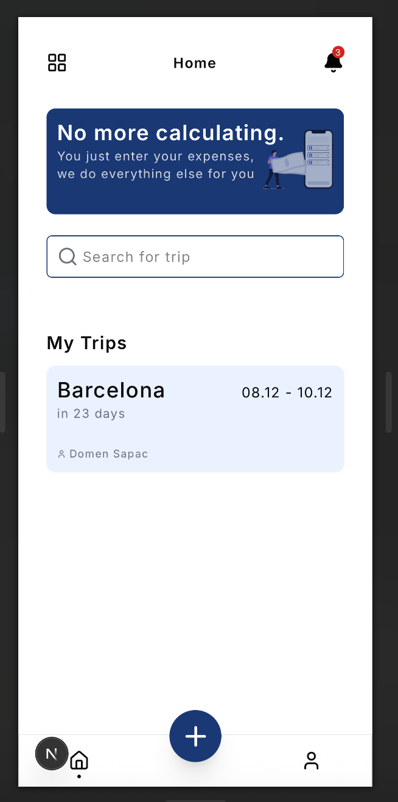
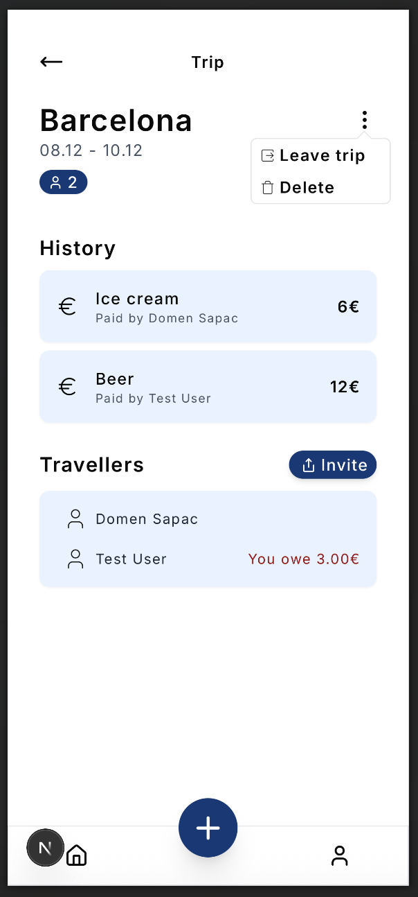

# WeTripping

<p float="left">
  
  
</p>

Tracking your expenses while you are traveling in a group can be a pain. This is why I got inspired to build this project. You just create your trips, invite your friends to join them and enter the expenses. The app does the calculating. 

**Demo:** [wetripping.vercel.app](https://wetripping.vercel.app/)

Built for mobile. For the best experience open Dev Tools (F12) and toggle mobile view.

**Demo account:** `bivoyi4538@jysnk.com` / `demouser123` 

App features
- Expense tracking
- Invites
- Basic notifications
- Profiles 

## Tech stack


 

## Getting Started
To get the project running on your local device, follow these steps.

### Prerequisites
Node.js 18 or newer

- macOS: `brew install node`
- Windows: `winget install OpenJS.NodeJS.LTS`

### Installation

1.  Clone the repo
    ```sh
    git clone https://github.com/domensapac/we-tripping.git
    ```
    ```sh
    cd we-tripping
    ```
2.  Create .env file and fill following
    ```sh
    NEXT_PUBLIC_SUPABASE_URL=
    NEXT_PUBLIC_SUPABASE_ANON_KEY=
    SMTP=
    SUPABASE_SERVICE_ROLE_KEY=
    ```
3.  Install NPM packages
    ```sh
    npm install
    ```
4.  Run it! 
    ```sh
    npm run dev
    ```
5.  See the app in browser
    ```sh
    Visit http://localhost:3000 in your browser
    ```